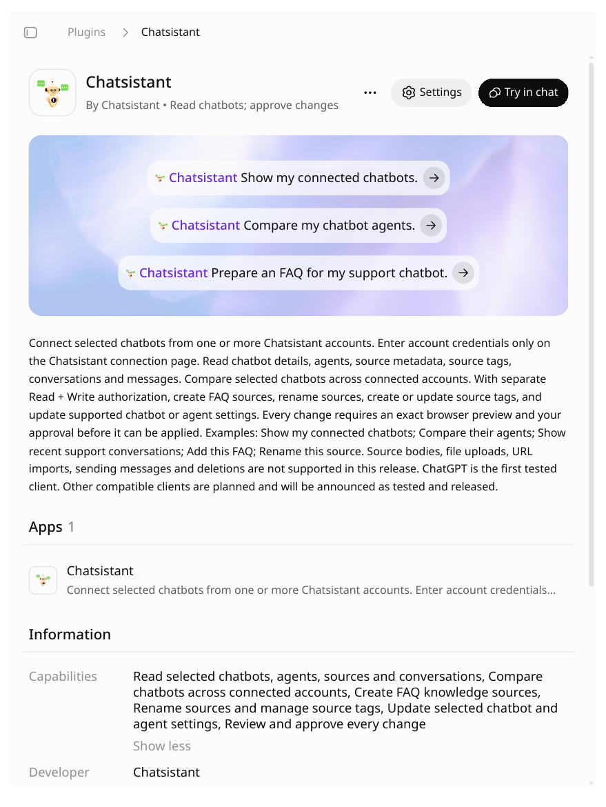
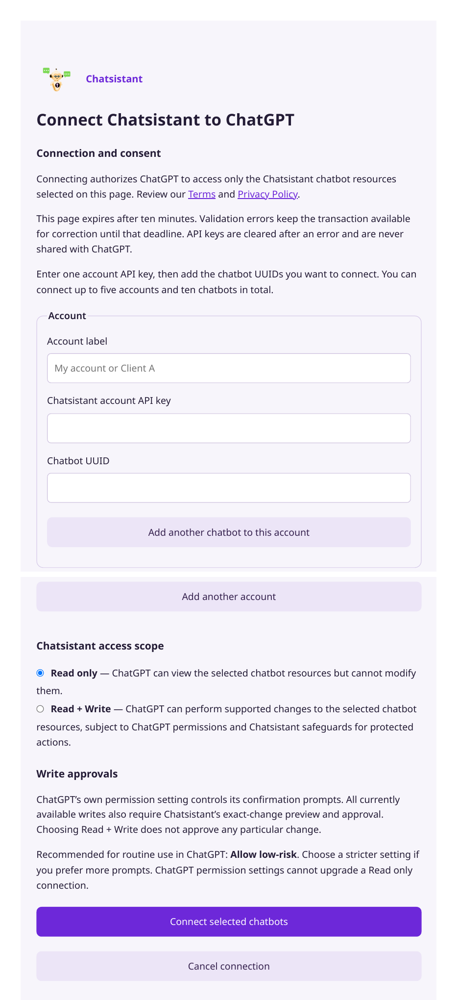
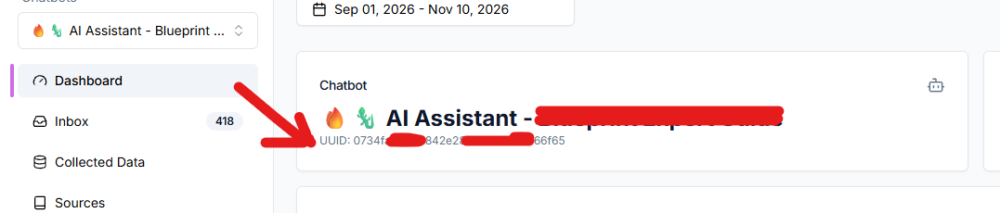

Chatsistant is live in ChatGPT through a first-party native MCP connection. Authorized users can work with supported Chatsistant resources conversationally, directly inside ChatGPT, while keeping permission scope and approved write actions under their control.

**Status: Live in ChatGPT** · Public plugin · OAuth authorization

### What you can do

- **Read** supported account data: chatbot details, agents, source metadata and tags, conversations, leads, bookings, and escalations.
-  **Write** (with approval): supported FAQ creation, source renaming, source-tag management, and selected writing workflows. Write actions are permission-scoped and approval-protected — nothing changes in your account without the connected user's authorization.

The Chatsistant plugin provides 19 tools for working with your chatbots, agents, sources, conversations, leads, and bookings. Published November 2, 2026.

<Card title="See Chatsistant Serve the Customer, Then See ChatGPT Work With Chatsistant" icon="sparkles" href="https://chatsistant.com/#cs-home-dual-demo" cta="Try the live demo">
  Try the interactive two-sided demo on chatsistant.com.
</Card>

### Connect Chatsistant in ChatGPT

1. Open the Chatsistant plugin in ChatGPT: [https://chatgpt.com/plugins/plugin_asdk_app_6acf0de6ec8c81919ed9bed49a7a705e](https://chatgpt.com/plugins/plugin_asdk_app_6acf0de6ec8c81919ed9bed49a7a705e)
2. Choose **Read Only** or **Read + Write** access.
3. On the Chatsistant connection page, enter an account label, your Chatsistant account API key, and the UUIDs of the chatbots you want to connect (you can connect up to five accounts and ten chatbots in total). Your API key is created in your Chatsistant account (see "Getting a Chatsistant API Key" in the API References section of these docs), and each chatbot's UUID is shown under the chatbot's name on its Dashboard — click the UUID to copy it.
4. Start asking ChatGPT about your chatbots, sources, conversations, leads, and bookings.

You can connect up to five accounts and ten chatbots in total. On the connection page, use 'Add another chatbot to this account' for more chatbots on the same account, or 'Add another account' to bring in another Chatsistant account with its own API key. Connected accounts are managed afterwards from the plugin's Settings in ChatGPT.

### Plans

Native MCP access is included with the 30-day free trial and with paid plans (Essential, Professional, Start-Up, Enterprise Lite, Enterprise Max), in Read Only or Read + Write mode. See Pricing for details.
